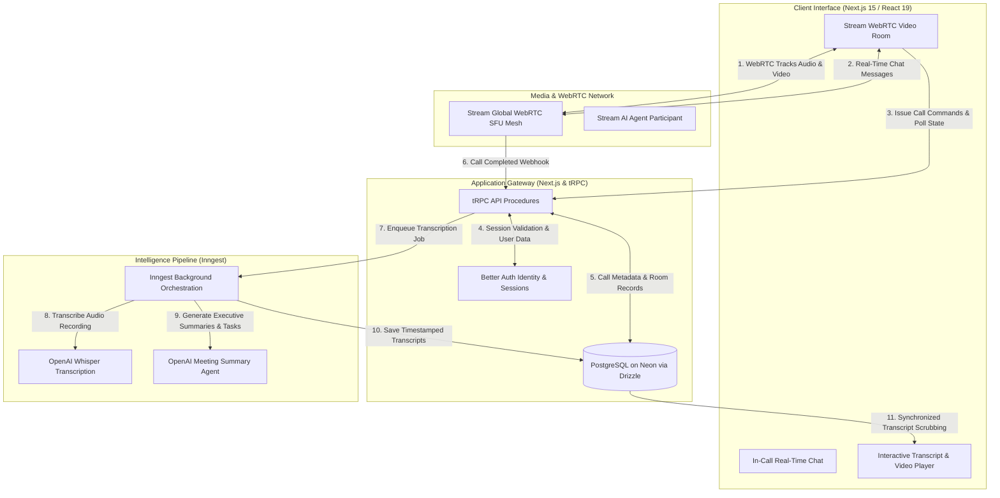

<div align="center">

# GNTI | Convene

<p><strong>AI-Powered Video Conferencing Platform with Real-Time Meeting Agents, Automated Transcripts & Smart Playback</strong></p>

<p>A flagship production foundation engineered by <a href="https://gnti.tech">Galaxy Nova Technologies & Innovations (GNTI)</a>.</p>

<p>
  <a href="https://gnti.tech"></a>&nbsp;
  <a href="https://github.com/GNTI-X/convene"></a>&nbsp;
  <a href="./LICENSE"></a>&nbsp;
  <a href="https://gnti.tech/projects/convene"></a>
</p>

</div>

---

## 📌 1. System Overview

**Convene** is an enterprise video conferencing and collaborative meeting intelligence platform. It seamlessly integrates WebRTC audio/video calls with autonomous real-time AI agents capable of joining conversations, providing instant live assistance, and synthesizing call proceedings into structured knowledge.

Built on Stream SDK's global low-latency edge network and powered by Inngest and OpenAI Whisper, Convene automatically transcribes recorded sessions, indexes meeting content by timestamped utterances, produces executive summaries and action item checklists, and enables semantic transcript search with synchronized video scrubbing.

---

## 🏛 2. Architecture & System Flow

### System Architecture Diagram



### End-to-End Workflow

1. **Room Allocation & Call Setup**:
   - Host initiates a meeting. The backend requests room tokens from Stream SDK and persists meeting parameters in Neon PostgreSQL.
   - Authentication is handled seamlessly through Better Auth session tokens.
2. **WebRTC Media Exchange**:
   - Stream SFU coordinates video and audio delivery across participants with adaptive bitrate streaming.
   - Real-time AI agent bots can join the call as virtual participants to listen and reply to queries.
3. **Automated Post-Call Intelligence**:
   - When the call concludes, Stream posts a recording completion webhook to the API.
   - Inngest enqueues an asynchronous post-processing job:
     - Downloads the audio recording.
     - Feeds audio into OpenAI Whisper to generate timestamped text chunks.
     - Passes transcripts to GPT-4o to generate structured summaries, sentiment tags, and follow-up action items.
4. **Smart Interactive Review**:
   - Users browse the meeting archive with keyword search. Clicking any word in the transcript instantly jumps video playback to the exact second it was spoken.

---

## 🛠 3. Categorized Tech Stack

| Domain | Technology | Purpose |
|:---|:---|:---|
| **Frontend Framework** | `Next.js 15` & `React 19` | Modern responsive meeting interface with mobile-first design |
| **Media & WebRTC** | `Stream Video SDK` | Global low-latency WebRTC video, screen sharing, and audio mesh |
| **API Layer** | `tRPC` & `Zod` | End-to-end typed client/server interactions |
| **Database & ORM** | `PostgreSQL` (Neon) via `Drizzle` | Meeting records, transcripts, accounts, and session tokens |
| **Authentication** | `Better Auth` | Multi-provider authentication and session token verification |
| **Async Processing** | `Inngest` | Resilient post-call transcription and meeting summarization pipelines |
| **AI Intelligence** | `OpenAI Whisper` & `GPT-4o` | High-fidelity transcription and structured meeting synthesis |
| **Monetization** | `Polar SDK` | Usage-based meeting credits, tiered subscriptions, and invoicing |

---

## 🗄 4. Domain Data Model & Entity Relationships

- **`user`**: `id`, `name`, `email`, `emailVerified`, `image`, timestamps
- **`session`**: `id`, `userId` (FK to `user`), `token`, `expiresAt`, `ipAddress`, `userAgent`
- **`account`**: Multi-provider credentials (OAuth access tokens, refresh tokens)
- **`meetings`**: `id`, `title`, `hostId`, `streamCallId`, `recordingUrl`, `status`
- **`transcripts`**: `id`, `meetingId` (FK), `content`, `summary`, `actionItems` (JSON), `segments` (Array of timestamped utterances)

---

## 🔑 5. Environment Variables Reference

| Variable | Required | Description |
|:---|:---:|:---|
| `DATABASE_URL` | **Yes** | PostgreSQL connection string |
| `NEXT_PUBLIC_APP_URL` | **Yes** | Public frontend URL |
| `NEXT_PUBLIC_STREAM_API_KEY` | **Yes** | Stream public application key |
| `STREAM_API_SECRET` | **Yes** | Stream private backend secret |
| `OPENAI_API_KEY` | **Yes** | OpenAI API key for Whisper and GPT-4o |
| `BETTER_AUTH_SECRET` | **Yes** | Secret encryption salt for session cookies |
| `BETTER_AUTH_URL` | **Yes** | Base URL for authentication handlers |
| `INNGEST_EVENT_KEY` | **Yes** | Inngest event emission key |
| `INNGEST_SIGNING_KEY` | **Yes** | Inngest webhook signature key |
| `POLAR_ACCESS_TOKEN` | Optional | Polar billing API token |

---

## 🚀 6. Local Development & Deployment

```bash
# 1. Clone repository
git clone https://github.com/GNTI-X/convene.git
cd convene

# 2. Configure environment
cp .env.example .env

# 3. Install dependencies
npm install

# 4. Push Database Schema
npm run db:push

# 5. Start Inngest local orchestrator (separate terminal)
npx inngest-cli@latest dev

# 6. Run development server
npm run dev
```

---

## 🏢 About GNTI

Galaxy Nova Technologies & Innovations (GNTI) builds and deploys scalable software across multi-tenant SaaS, real-time communication, AI automation, and media streaming infrastructure.

- **Website**: [gnti.tech](https://gnti.tech)
- **Official Specification**: [gnti.tech/projects/convene](https://gnti.tech/projects/convene)
- **Inquiries**: [contact@gnti.tech](mailto:contact@gnti.tech)

---

## 📄 License

Distributed under the **MIT License**. See [LICENSE](./LICENSE) for details.

Copyright &copy; 2026 [Galaxy Nova Technologies & Innovations (GNTI)](https://gnti.tech). All rights reserved.
